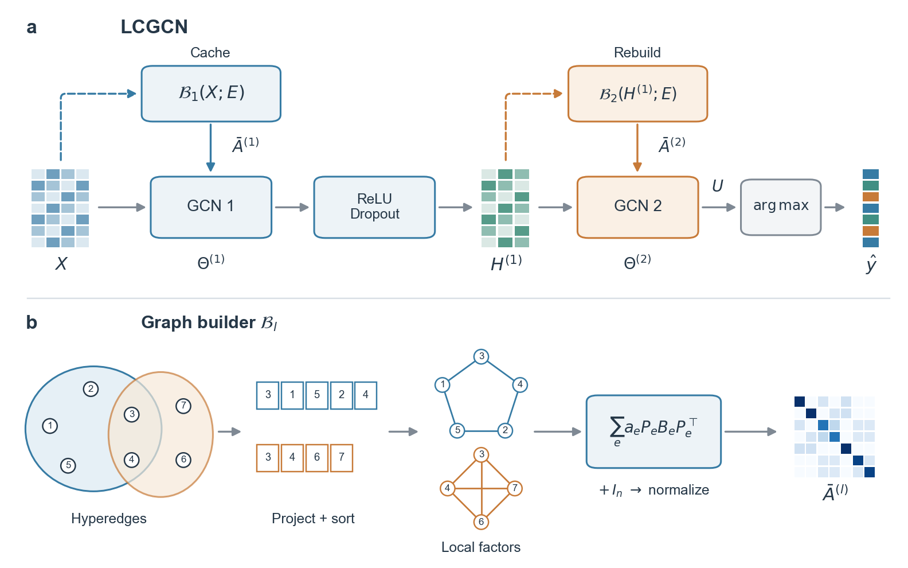

# LCGCN

Research implementation of **LCGCN**, **NativeLCGCN**, and **FastLCGCN** for hypergraph vertex classification.

[中文使用说明](docs/README.zh-CN.md) | [Data documentation](docs/DATA.md) | [Reproducibility](docs/REPRODUCIBILITY.md) | [Development](docs/DEVELOPMENT.md)



The framework uses the symbol-corrected manuscript figure updated on November 12, 2026. [SVG](docs/assets/framework.svg) · [PDF](docs/assets/framework.pdf) · [Figure notes](docs/FRAMEWORK.md)

Code and documentation are available under the [MIT license](LICENSE). This repository contains the three model implementations and all 450 frozen main-experiment configurations. Training computes new results; historical scores or pretrained checkpoints are not substituted for training.

**Data availability:** the five preprocessed datasets and 50 supplied splits are **not included in this public repository**, because their redistribution provenance is still being verified. The expected file hashes and split statistics are included. Training requires an authorized local copy of those inputs; see [Data documentation](docs/DATA.md). Downloading the code alone is sufficient for the synthetic tests and configuration listing, but not dataset training.

## Quick start

Clone the repository (or extract GitHub's Download ZIP), open the project folder containing `main.py` in VS Code, and install the dependencies as described below:

```shell
git clone https://github.com/shangchao0819-lgtm/LCGCN.git
cd LCGCN
```

After installation, these commands work without a dataset:

```shell
python -m unittest discover -s tests -v
python main.py --all --list
```

With an authorized input collection containing `manifest.json`, features, labels, hypergraphs, and all splits:

```shell
python main.py --data-dir "path/to/data" --check --device cpu
python main.py --data-dir "path/to/data"
```

Alternatively, place the complete authorized collection in the ignored `data/` directory beside `main.py`, then run `python main.py`.

The default run trains LCGCN on Cora-CA, split 1, initialization seed 1, for **200 epochs**, and evaluates the final checkpoint. CUDA is selected when available; otherwise the program uses the CPU. A single run typically takes seconds to minutes depending on hardware, dataset, and model. The default is one fit, not the full main comparison.

```text
LCGCN/
  main.py                 # VS Code/source-checkout entry point
  pyproject.toml          # Package, dependencies, and console entry point
  requirements.txt
  README.md
  lcgcn/                  # Models, graph construction, training, and reporting
    configs/main_450.json
  data/                   # User-supplied inputs; excluded from GitHub
    manifest.json
    coauthorship/{cora,dblp}/
    cocitation/{cora,citeseer,pubmed}/
  docs/
  tests/
```

The required local input layout is shown above. Each dataset directory contains `features.pickle`, `labels.pickle`, `hypergraph.pickle`, and `splits/1.pickle` through `splits/10.pickle`. There are 65 input files in total.

## Installation

The validated environment is Windows, Python 3.10.18, PyTorch 2.7.1+cu128, NumPy 2.2.6, SciPy 1.15.3, and scikit-learn 1.7.2. Package metadata currently limits Python to 3.10. Other Python versions and Linux execution have not been validated locally. No torch-scatter, PyG, DGL, or custom sparse extension is required.

From the project root, create a Python 3.10 environment. For Windows PowerShell:

```powershell
py -3.10 -m venv .venv
.\.venv\Scripts\python.exe -m pip install --upgrade pip
.\.venv\Scripts\python.exe -m pip install torch==2.7.1 --index-url https://download.pytorch.org/whl/cpu
.\.venv\Scripts\python.exe -m pip install -e .
```

For NVIDIA CUDA 12.8, replace the PyTorch installation command with:

```powershell
.\.venv\Scripts\python.exe -m pip install torch==2.7.1 --index-url https://download.pytorch.org/whl/cu128
```

Select `.venv/Scripts/python.exe` in VS Code using **Python: Select Interpreter**, then open a new terminal. If the terminal is not activated, use `.\.venv\Scripts\python.exe` in place of `python`. Check the selected interpreter with `python -c "import sys; print(sys.executable)"`. An existing compatible environment may be reused. Official wheel instructions are available in the [PyTorch version archive](https://pytorch.org/get-started/previous-versions/).

## Commands

```shell
# Verify all input hashes and all 50 splits; no training
python main.py --check --device cpu

# Three real epochs for an execution check; not a paper result
python main.py --smoke --device cpu

# Individual main-table fits
python main.py --model native-lcgcn --dataset citeseer --split 1 --seed 8
python main.py --model fast-lcgcn --dataset pubmed --split 1 --seed 17 --device cuda

# Complete own-model main comparison: 450 fits, 200 epochs each
python main.py --all --device cuda

# Inspect the frozen plan without training
python main.py --all --list
```

The complete plan contains 3 models x 5 datasets x 10 splits x 3 seeds. Budget hours and several GB of output space; CPU execution may take longer. Baseline models and supplemental experiment suites are outside this package's runnable scope.

`python -m lcgcn` is equivalent to `python main.py`. After installation, the `lcgcn` console command is also available. For a source checkout or editable installation, default data/output paths are relative to the project, not the terminal's current directory. You may run `python "path/to/LCGCN/main.py"` from elsewhere. Explicit relative paths are resolved against the current directory.

```shell
python main.py --data-dir "path/to/data" --output-dir "path/to/results"
```

Ordinary wheels include the frozen configurations but not datasets. For a wheel installation, supply `--data-dir`; without an override, data and outputs are located under the current directory. If you already have an authorized `LCGCN_data.zip`, extract it locally and pass its `LCGCN_data/data` directory to `--data-dir`. That archive is not distributed by this repository.

## Terminal output and artifacts

Every completed fit prints the model, dataset, split, actual initialization seed, epochs, device, test accuracy, test-node count, timing, checkpoint verification status, and artifact directory. Training loss is printed at epoch 1, every 20 epochs, and the final epoch.

Two statistics are explicitly separated:

- **Run summary:** mean and sample SD of individual fit accuracies. This SD is not the paper-table SD.
- **Paper statistics:** average seeds 1, 8, and 17 within each split, then compute the mean and sample SD across ten split means. A complete, duplicate-free set of 30 final-200 fits on one device is required; otherwise this reports N/A. Smoke runs never qualify.

Each invocation creates a new `outputs/train-<timestamp>-<id>/` directory; smoke runs use `smoke-`. The text summary is saved as `summary.txt`, with structured records in `summary.json`. Per-fit artifacts include `history.json`, `model.pt`, `predictions.npz`, `result.json`, partitions, final graphs, source snapshots, and hashes. Previous runs are not overwritten.

The final checkpoint is reloaded and checked against saved logits, predictions, and graph hashes. Exit code 0 indicates successful execution and reload checks. Code 2 indicates an argument/data error or a failed numerical reload check; inspect the terminal and artifacts. Other failures include a traceback. Failed checks retain the artifacts for investigation; do not select reruns by test score.

## Model and experiment protocol

The first-layer graph is cached. LCGCN rebuilds its second-layer graph from the post-ReLU, post-dropout hidden representation, with graph construction detached from backpropagation. Evaluation disables dropout and rebuilds that graph. NativeLCGCN retains the stored vertex order; FastLCGCN orders once from the input features. Both fixed variants reuse their operator at both layers.

Each local factor has total undirected edge weight one. Overlapping contributions are summed; the identity is added once before symmetric normalization. The classifier has no biases or output ReLU and uses logits with cross-entropy and argmax evaluation.

The main recipe uses Adam, learning rate 0.01, weight decay 0.0005, dropout 0.5, hidden width 64 for Citeseer and 16 otherwise, and the final checkpoint after 200 epochs. Initialization seeds 1/8/17 map to internal repeat indices 9/1/23, with separate graph and evaluation streams. **These seeds were retained after earlier exploration using test outcomes; they were not prespecified.** Historical seed-8 results partly reused earlier selection records. This package executes the frozen final recipes without repeating parameter selection.

Exact historical scores and bitwise identity across devices/runs are not guaranteed. Read the [reproducibility notes](docs/REPRODUCIBILITY.md) before comparing results with the paper.

## License

The code and accompanying documentation are licensed under MIT; retain the copyright and license notice when redistributing. Third-party datasets and dependencies retain their own terms. The repository does not grant a new license for those datasets.
